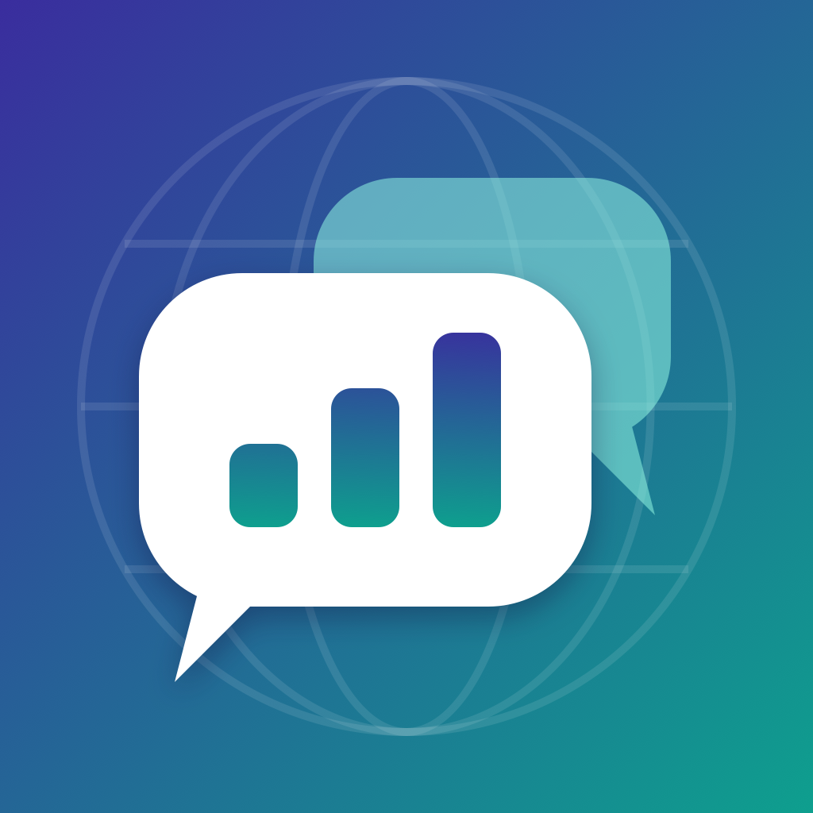
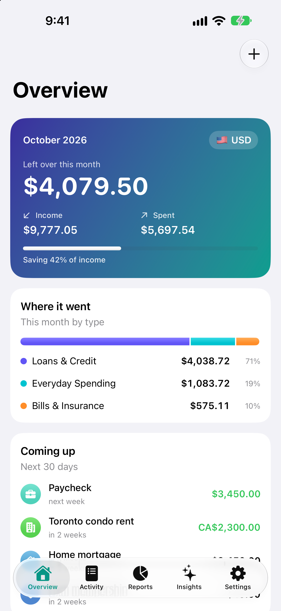
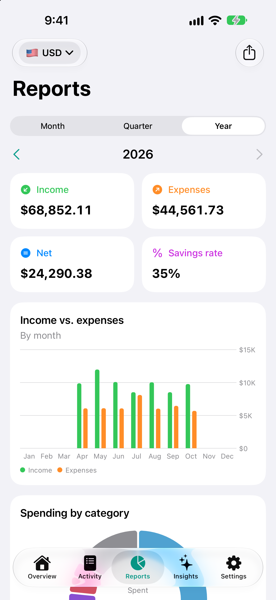
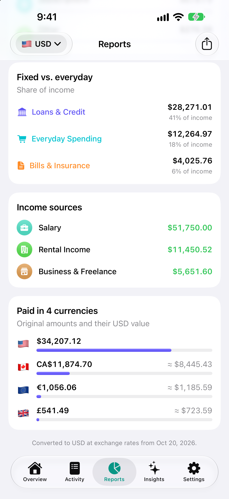
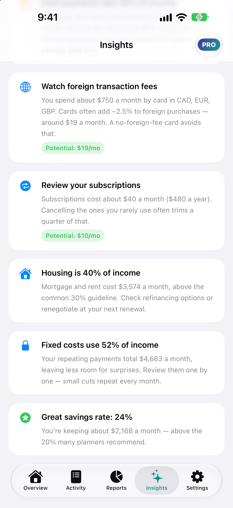

<p align="center">
  
</p>

<h1 align="center">Moneyglot</h1>

<p align="center"><b>Every currency. One clear picture.</b><br>
A multi-currency income &amp; expense tracker for iPhone with an on-device AI money coach.</p>

<p align="center">
  
  
  
  
</p>

<p align="center">
  
  
  
  
</p>

## Why

People who earn in one currency, pay a mortgage in another and spend on holiday in a third have no simple way to see their whole financial picture. Moneyglot stores every entry in the currency it actually happened in and converts everything on the fly into whichever currency you want to report in.

## Features

| | |
|---|---|
| **Track everything** | Income, mortgage, car loan, credit card, bills, insurance, subscriptions and everyday spending across 25 categories in 4 groups |
| **160+ currencies** | Live exchange rates (cached, with an offline fallback bundled in the app), searchable picker with pinned favourites and flags |
| **Repeating payments** | Weekly → yearly schedules that automatically record entries on each due date, with month-end-safe date math, pause/resume and end dates |
| **Reports** | Month / quarter / year, switchable report currency, income vs. expenses chart, category donut, fixed-vs-everyday split as % of income, "paid in N currencies" breakdown, CSV export |
| **Moneyglot Pro** *(subscription)* | Rule-based smart insights (debt-to-income, housing ratio, category spikes, subscriptions, foreign-card fees…) plus a personal savings plan generated by Apple's **on-device** Foundation Models — no server, no data leaves the phone |
| **Private by design** | No account, no analytics, no tracking. Privacy manifest included |

## Tech stack

- **SwiftUI** (iOS 18+, Liquid Glass on iOS 26+), **Swift Charts**
- **SwiftData** for persistence (CloudKit-ready model: defaults on every property, no unique constraints)
- **Observation** (`@Observable`) services injected through the environment
- **StoreKit 2** with `SubscriptionStoreView` and a local `.storekit` configuration for testing
- **FoundationModels** (`LanguageModelSession` + `@Generable` structured output) behind `#if canImport` / `#available` so the app still runs on iOS 18
- **Swift Testing** unit tests for all money logic

## Architecture

```
Moneyglot/
├── App/            App entry point, tab root, startup tasks
├── Models/         SwiftData models (Entry, RecurringPayment) + category/frequency enums
├── Services/       Pure, testable logic
│   ├── CurrencyService.swift     rates download/cache + CurrencyConverter (pure)
│   ├── ReportBuilder.swift       periods, aggregation, buckets → Report
│   ├── RecurringScheduler.swift  due-date math → entries
│   ├── InsightsEngine.swift      financial snapshot + rule-based insights
│   ├── AIAdvisor.swift           on-device LLM plan (Foundation Models)
│   ├── StoreManager.swift        StoreKit 2 subscription state
│   └── CSVExporter.swift         RFC-4180 CSV + Transferable
├── Views/          Overview, Activity, Reports, Insights (+ paywall), Settings
└── Resources/      Asset catalog, privacy manifest, bundled fallback rates
MoneyglotTests/     Swift Testing suites (reports, conversion, scheduling, insights, CSV, parsing)
docs/               GitHub Pages: support page + privacy policy
AppStore/           Listing copy, launch checklist, screenshots
Tools/              App-icon generator (CoreGraphics script)
```

Views read SwiftData with `@Query`, map models to plain value snapshots (`EntrySnapshot`), and hand them to pure engines (`ReportBuilder`, `InsightsEngine`). That keeps all of the money math independent of UI and storage, so it is fully unit tested.

Amounts are stored as `Decimal` in their original currency. Conversion happens at read time through USD-based cross rates, so changing the report currency never rewrites data.

## Getting started

1. Open `Moneyglot.xcodeproj` in **Xcode 26 or later**.
2. Select an iPhone simulator and press **⌘R**.
3. On the empty Overview screen, tap **Load sample data** (Debug builds only) to explore 7 months of multi-currency demo data.
4. To try Pro: run from Xcode, which uses `Moneyglot/Moneyglot.storekit` for sandbox purchases, or toggle **Settings › Developer › Unlock Pro** (Debug only).

Run the tests with **⌘U**, or:

```bash
xcodebuild test -project Moneyglot.xcodeproj -scheme Moneyglot -destination 'platform=iOS Simulator,name=iPhone 17'
```

The AI savings plan needs an Apple Intelligence-capable device (or a Mac with Apple Intelligence enabled when using the Simulator). Everywhere else the app falls back to the rule-based insights.

## Roadmap

- [ ] iCloud sync across devices (CloudKit)
- [ ] Historical exchange rates (convert at the rate on the transaction date)
- [ ] Monthly budgets per category with alerts
- [ ] Loan tracker: remaining balance, interest and payoff date
- [ ] Home Screen and Lock Screen widgets
- [ ] Face ID app lock
- [ ] Receipt scanning
- [ ] Localization (Arabic, French, Hindi, Spanish, Urdu…)

## Credits

Exchange rates by [ExchangeRate-API](https://www.exchangerate-api.com). Icons from SF Symbols.

## License

Copyright © 2026 [asfateh](https://github.com/asfateh). All rights reserved. The source is public for portfolio purposes; please don't republish the app.
